# Villa Bomada — Guest Manager

A mobile app for managing guests and reservations across a 7-apartment
accommodation property. Built to replace the paper notebook and spreadsheet
the property was managed with.

Used daily by three people on separate devices, with all data kept in sync.

## Features

- **Property timeline** — all 7 apartments on a horizontal calendar, with
  reservations shown as colour-coded bars (green for Booking.com guests,
  blue for direct bookings, yellow for friends and family)
- **Availability search** — check which apartments are free for a given date
  range, optionally narrowed to a single apartment
- **Daily plan** — check-outs, check-ins, cleaning and scheduled apartment
  visits for any given day, with checkboxes and free-form notes
- **Guest schedule** — per-night breakdown of each stay with automatically
  suggested apartment visits, which can be moved to another day or removed
- **Configurable service rules** — how often to enter an apartment during a
  stay, set separately for each booking type
- **Apartment overview** — current status, who is staying and when the next
  guest arrives

## Architecture

The app talks to Supabase directly from the device — there is no custom
backend. Access control is enforced in the database through Row Level
Security rather than in the client.

Data is scoped per property: a `clanovi` table maps each authenticated user
to the property they belong to, and every RLS policy checks that mapping
before returning rows. A user only ever sees data belonging to their own
property, which keeps the schema ready for multiple properties without
changes to the application code.

Reservation conflicts, stay length and service dates are computed in the
client from ISO date strings, which sort and compare correctly as plain text.

## Database

| Table | Purpose |
|---|---|
| `objekti` | Properties |
| `clanovi` | Maps users to properties (many-to-many) |
| `gosti` | Reservations |
| `servisi` | Scheduled apartment visits during a stay |
| `postavke` | Per-property service rules |
| `zadaci` | Free-form daily notes |
| `odradeno` | Completed task keys |

All tables have RLS enabled and are only readable by members of the
corresponding property.

## Built with

- React Native + Expo (Expo Router)
- TypeScript
- Supabase (PostgreSQL, Auth, Row Level Security)

## Running locally

Clone the repository and install dependencies:
npm install

Create a Supabase project and set up the tables listed above, then copy the
environment file and fill in your project credentials:

cp .env.example .env

Start the development server:

npx expo start

Open the project in Expo Go, an Android emulator or an iOS simulator.

## Screenshots

### Home

A snapshot of the property on open: how many apartments are occupied,
how many are free, and how many arrivals and departures are due today.

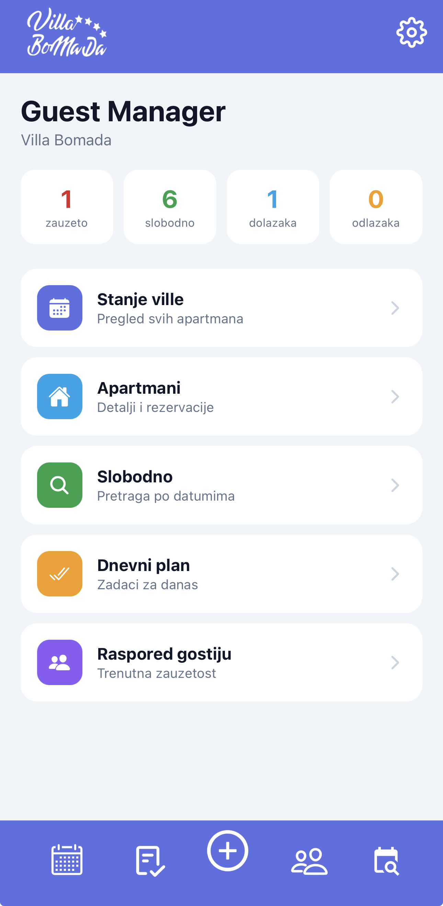

### Property timeline

All apartments on one horizontal calendar. Each reservation is a bar
spanning its nights, coloured by booking type, and tapping one opens
that guest. The current day is highlighted.

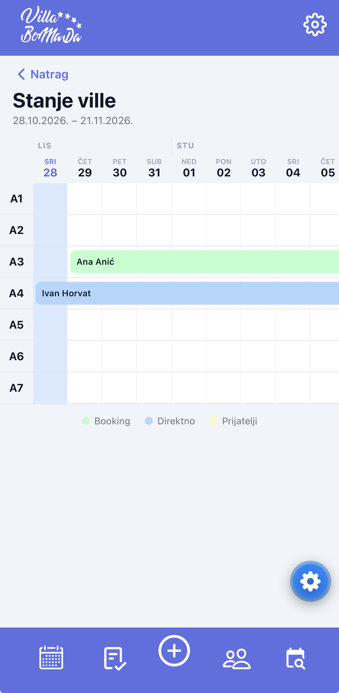

### Current occupancy

Who is in the property right now, and which apartments are free.

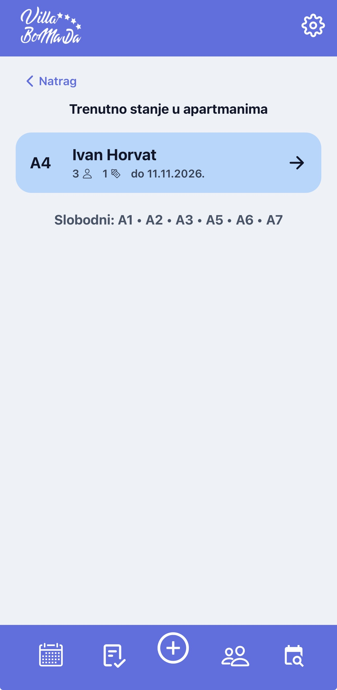

### Apartments

Every apartment with its current status — who is staying and until when,
or whether it is free.

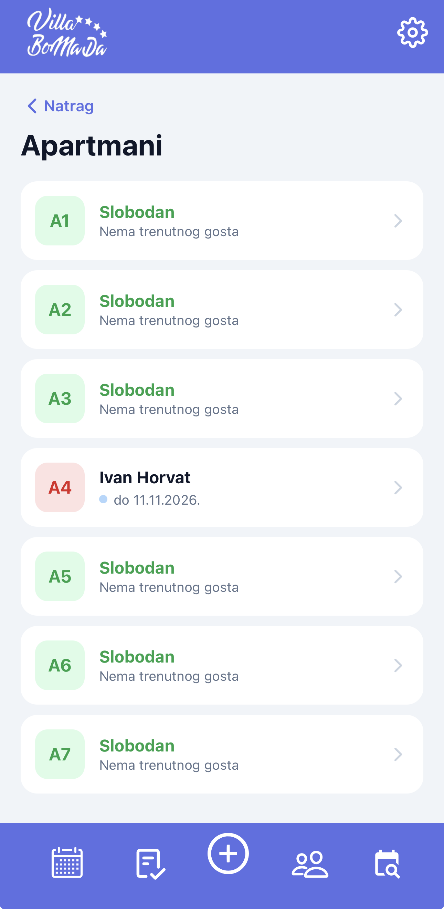

### Apartment detail

The current guest, how many nights remain, and who arrives next.

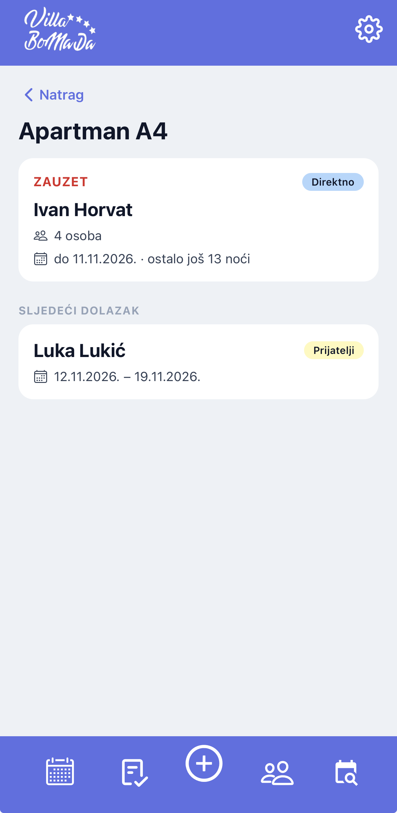

### Guest detail and stay schedule

Each stay is broken down night by night. Apartment visits are suggested
automatically from the service rules and can be moved to another day or
removed; manual changes survive later edits to the reservation.

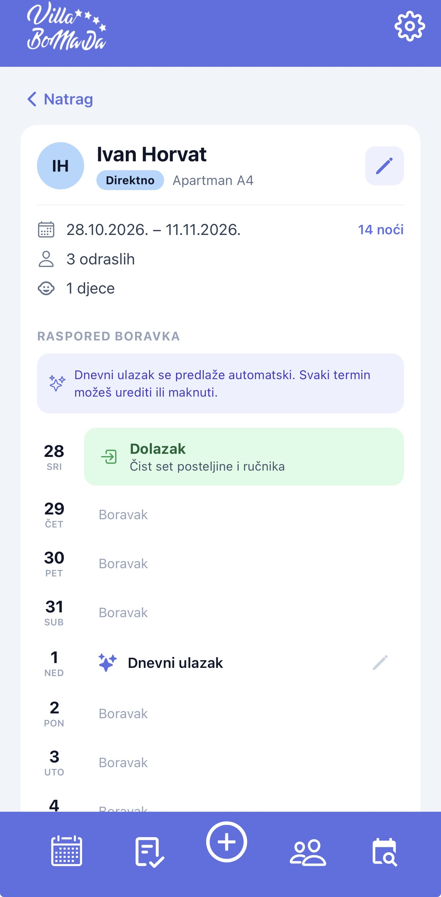
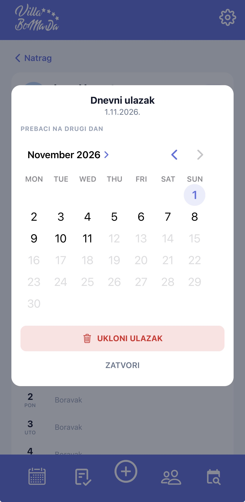

### Editing a reservation

Dates and party size can be changed after the fact; the stay schedule is
recalculated around any manual adjustments.

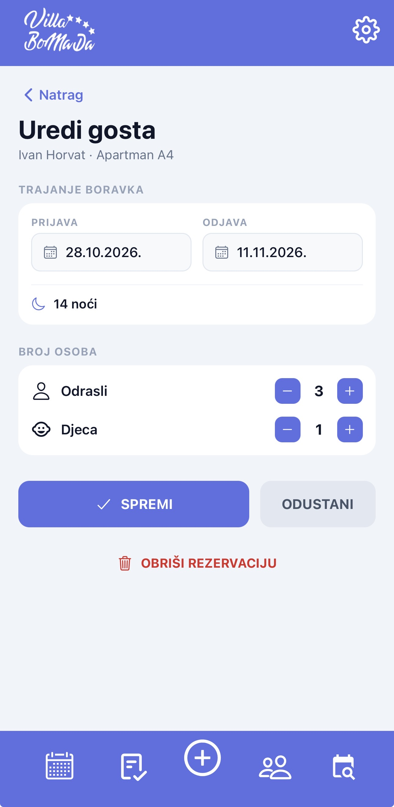

### Daily plan

Everything due on a given day — departures, arrivals, cleaning and
scheduled visits — with checkboxes and free-form notes. Checked items
persist across devices.

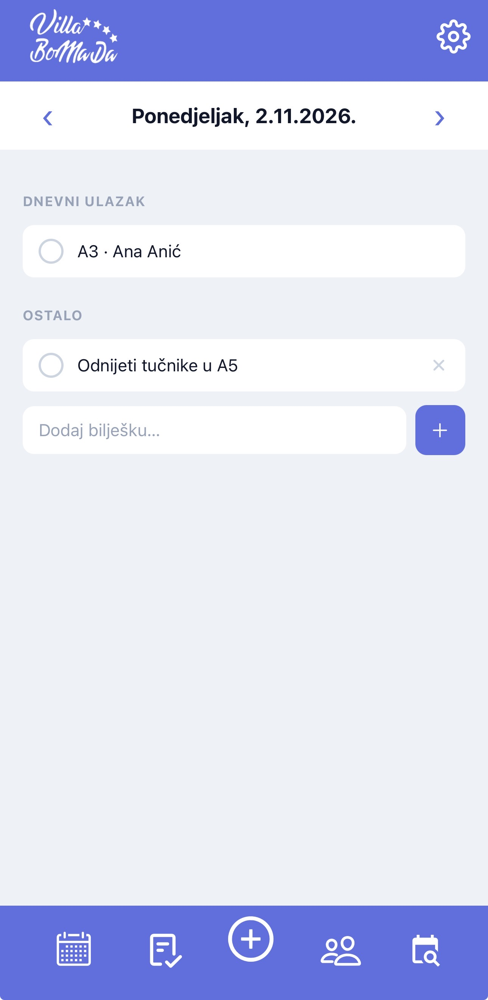

### New reservation

Apartment, dates, party size and booking type. Overlapping reservations
and past dates are rejected before saving.

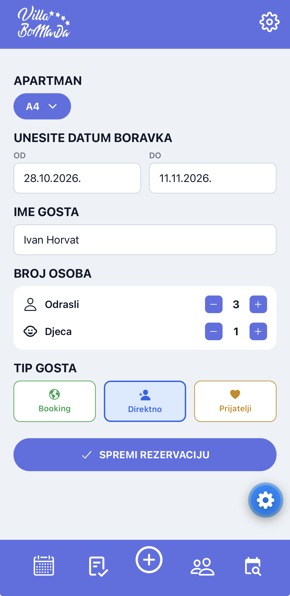

### Availability search

Which apartments are free from a chosen date, optionally narrowed to one
apartment, with the date each one is free until.

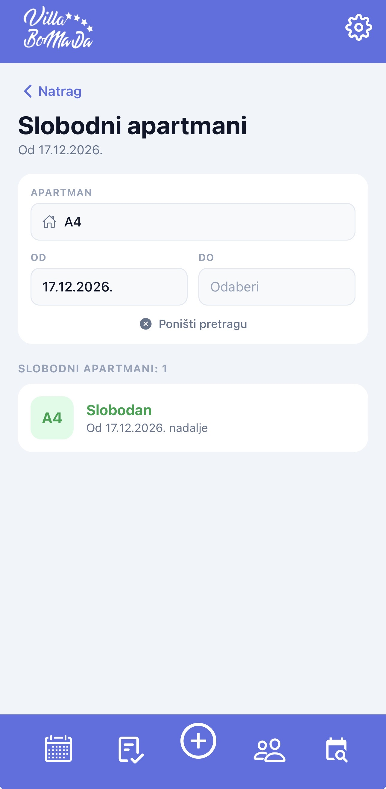

### Settings

Service intervals per booking type, property details and sign-out.

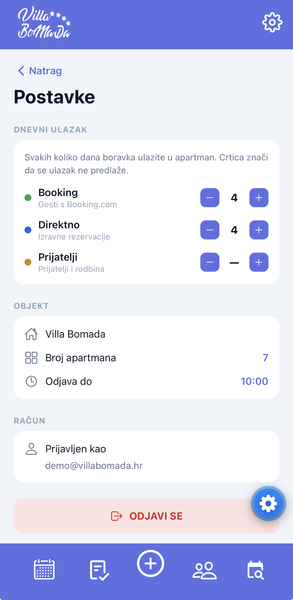